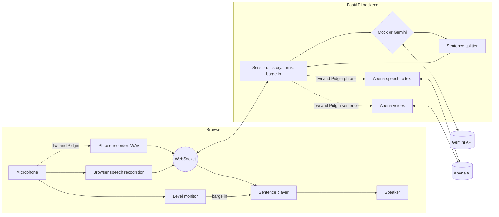

# Voice Assistant

A real time voice assistant that runs in the browser. You talk, Gemini answers, and the
answer is spoken back sentence by sentence. It works out which language you spoke
(English, French, Spanish, Twi, Ghana Pidgin or Naija Pidgin) and answers in it. You can
interrupt it mid sentence (barge in).

It runs with **no API keys at all** in mock mode, and switches each piece to the real
service once `MOCK_MODE=false` and its key are in `.env`. The free tiers of Google AI
Studio and Abena are enough to try it.

## How it flows



Solid lines are always used. Dotted lines are only used for Twi and Pidgin, with mock mode off.

1. The browser's own speech recognition turns what you say into text. It listens in the language picked on the page, and in English when the picker is on "Detect automatically".
2. When Ghana Twi or a Pidgin is picked, the page instead records each phrase (it finds the start and end itself) and sends it as WAV to the backend, where Abena's speech recognition turns it into text.
3. The text goes to Gemini, which answers as JSON: the language it replies in, and the reply. The reply is streamed.
4. The reply is cut into sentences. Each finished sentence is sent at once. English, French and Spanish are spoken by the browser's voices. Twi and both Pidgins are spoken by Abena voices.
5. If you talk, type or press Stop while it is answering, the reply is cancelled on both sides.

The exact messages are written down in [docs/protocol.md](docs/protocol.md).

## Setup

Needs Python 3.11 or newer.

```bash
python -m venv .venv
```

```bash
.venv\Scripts\activate
```

```bash
pip install -r requirements.txt
```

On macOS or Linux the second command is `source .venv/bin/activate`.

## Run

```bash
uvicorn app.main:app --reload
```

Open http://localhost:8000 in Chrome or Edge. Press the microphone and talk, or type.
On Windows you can double click `start.bat` instead. It uses port 8001 and opens the page.
The badges in the top right show which mode each piece is in.

### Using real services

Copy `.env.example` to `.env`, set `MOCK_MODE=false`, and fill in the keys you have.
Each piece falls back by itself:

| Piece | With `MOCK_MODE=false` | In mock mode, or without its key |
| --- | --- | --- |
| Replies and language detection | Gemini (needs `GEMINI_API_KEY` and `GEMINI_MODEL`) | Canned mock replies |
| Listening for Twi and Pidgin | Abena (no key needed) | Browser speech recognition |
| Voice for Twi and Pidgin | Abena (no key needed, `ABENA_API_KEY` optional) | Browser speech synthesis |

English, French and Spanish are always heard and spoken by the browser, so they use no credits.
Automatic detection works on the text: type or say something and Gemini answers in that
language. By ear the browser only listens in one language at a time, so to speak Twi or
Pidgin, pick that language first.
Keys stay on the backend. The browser is only told the mode names and the voice names.

### Language and voice

The language picker defaults to "Detect automatically". Pick a language to force it.
Choose Woman or Man, then a voice. Twi and Pidgin offer Abena's voices by name. Abena has
only one Twi man (Kofi) and no Pidgin woman, so the Pidgin women (Akua, Chioma) are its
English voices with a Ghanaian or Nigerian accent reading the Pidgin text. Other languages
list the browser's voices, so Spanish and French need those voices installed on your
computer.

### Limits of the free tiers

* **Abena** allows 20 requests a minute and 100 an hour without a key, and the text to
  speech trial is small. Its speech recognition has only 10 to 20 free transcriptions, so
  spoken Twi and Pidgin run out quickly. Typing always works.
* **Gemini** has its own free quota, and it is small: a handful of requests a minute. When
  it runs out the page says so and asks you to wait a minute. A request that stalls is
  tried once more.
* Web search is not available. The free Gemini tier has no quota for Google Search (checked
  in November 2026: it answers 429). Mock mode still fakes a search for the page.

### Trying the mock

In mock mode, a message with a word like *weather*, *news*, *price* or *search* gets a
fake web search. Add the word *unreachable* to see a search that fails.

## Test

```bash
pytest
```

All tests run with no keys and no network. Gemini and Abena are faked. Two tests of the
speech player run it in Node and are skipped when Node is not installed.
`tests/conversations.json` holds whole conversations that are replayed in mock mode as a
regression check. Add one whenever you fix a bug.

## Speed

The page measures the time from the end of your speech to the first spoken word, shows
it under the status, and the backend logs it. The goal is under 1.5 seconds for answers
in a browser voice.

| Setup | Measured | Notes |
| --- | --- | --- |
| Mock replies, browser voice | 0.9 to 1.3 s | Measured in an embedded Chromium while building. Almost all of it is the browser voice starting up. |
| Real Gemini, typed, browser voice | 1.7 to 1.8 s | Measured in an embedded Chromium, November 2026. Gemini's first sentence is ready after about 1.2 s. |
| Real Gemini, typed, Abena Twi voice | about 8 s | Abena needs 4 to 8 s to make the audio for a sentence. The status shows "Preparing the voice" meanwhile. |
| Spoken into a real microphone | not measured yet | Run it, read the number under the status, and write it here. |

## Known limits

* **Barge in by voice depends on your speakers.** The page ignores the assistant's own
  voice using echo cancellation plus a loudness check, but loud speakers close to the
  microphone can still trigger it or mask you. Headphones are the reliable setup. The
  Stop button, the Esc key and typing always work.
* The phrase recorder (Twi and Pidgin) ends a phrase after 0.8 s of quiet and ignores
  very short sounds.
* With browser speech recognition, the first word or two of a barge in can be lost, and
  on phones barge in by voice is off. Use Stop.
* Browser speech recognition needs Chrome, Edge or Safari. Firefox gets the text box,
  except for Twi and Pidgin, which Abena hears in any browser.
* Sentences that end in an abbreviation such as "etc." are joined with the next one.
* Conversation history lives in memory for the life of the connection. A reconnect
  starts a new conversation.
* Not deployed anywhere. It runs on your own machine.

## Project layout

```
app/main.py          routes: the page, /health, /ws
app/session.py       one connection: history, turns, barge in, phrases, audio
app/brain.py         picks mock or Gemini
app/gemini.py        Gemini streaming, reads the JSON reply as it arrives
app/abena.py         Abena speech to text and text to speech
app/abena_voices.py  the Abena voices offered per language
app/languages.py     the languages and their prompts
app/mock.py          canned replies and fake search
app/sentences.py     cuts a text stream into sentences
app/static/          the page (plain HTML, CSS and JavaScript)
docs/                spec and message format
tests/               pytest tests and regression conversations
```
