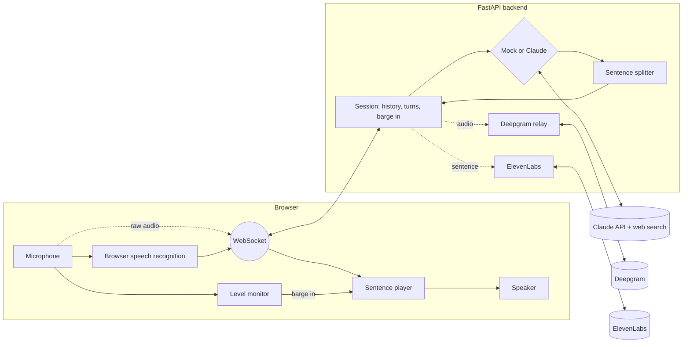

# Voice Assistant

A real time voice assistant that runs in the browser. You talk, Claude answers in a
streamed reply, and the answer is spoken back sentence by sentence. You can interrupt
it mid sentence (barge in), and it can look things up on the web when a question needs
current information.

It runs with **no API keys at all** in mock mode, and switches each piece to the real
service as soon as its key is in `.env`.

## How it flows



Solid lines are always used. Dotted lines are only used when that service's key is set.

1. The browser turns your speech into text (or sends audio to the backend for Deepgram).
2. The text goes to the backend over one WebSocket. The backend asks Claude and streams the reply.
3. The reply is cut into sentences. Each finished sentence is sent at once and spoken as soon as it arrives.
4. If Claude decides to search the web, the page shows "Searching the web" and says "Let me look that up" so there is no silence. Source links appear in the transcript and are never read aloud.
5. If you talk, type or press Stop while it is answering, the reply is cancelled on both sides.

The exact messages are written down in [docs/protocol.md](docs/protocol.md).

## Setup

Needs Python 3.11 or newer.

```bash
python -m venv .venv
```

```bash
.venv\Scripts\activate
```

```bash
pip install -r requirements.txt
```

On macOS or Linux the second command is `source .venv/bin/activate`.

## Run

```bash
uvicorn app.main:app --reload
```

Open http://localhost:8000 in Chrome or Edge. Press the microphone and talk, or type.
The badges in the top right show which mode each piece is in.

### Using real services

Copy `.env.example` to `.env`, set `MOCK_MODE=false`, and fill in the keys you have.
Each piece falls back by itself if its key is missing:

| Piece | With its key | Without |
| --- | --- | --- |
| Replies | Claude, with web search (`ANTHROPIC_API_KEY`) | Canned mock replies |
| Listening | Deepgram (`DEEPGRAM_API_KEY`) | Browser speech recognition |
| Voice | ElevenLabs (`ELEVENLABS_API_KEY` and `ELEVENLABS_VOICE_ID`) | Browser speech synthesis |

Keys stay on the backend. The browser is only told the mode names.

Web search is billed by Anthropic per search on top of the normal token cost.
`WEB_SEARCH_MAX_USES` limits how many searches one reply may make.

### Trying the mock

In mock mode, a message with a word like *weather*, *news*, *price* or *search* gets a
fake web search. Add the word *unreachable* to see a search that fails.

## Test

```bash
pytest
```

All tests run with no keys and no network. Claude, Deepgram and ElevenLabs are faked.
`tests/conversations.json` holds whole conversations that are replayed in mock mode as a
regression check. Add one whenever you fix a bug.

## Speed

The page measures the time from the end of your speech to the first spoken word, shows
it under the status, and the backend logs it. The goal is under 1.5 seconds for answers
without a web search.

| Setup | Measured | Notes |
| --- | --- | --- |
| Mock replies, browser voice | 0.9 to 1.3 s | Measured in an embedded Chromium while building. Almost all of it is the browser voice starting up. The backend had the first sentence ready in well under 0.1 s. |
| Mock replies, fake ElevenLabs audio | 0.9 s | Same browser, with a fake voice service that takes 0.3 s per sentence. |
| Real Claude, Deepgram, ElevenLabs | not measured yet | Needs real keys. Run it, read the number under the status, and write it here. |

"End of speech" means the moment the recogniser hands over the final text, so the
recogniser's own pause detection is not included in the number.

## Known limits

* **Barge in by voice depends on your speakers.** The page ignores the assistant's own
  voice using echo cancellation plus a loudness check, but loud speakers close to the
  microphone can still trigger it or mask you. Headphones are the reliable setup. The
  Stop button, the Esc key and typing always work.
* With browser speech recognition, the first word or two of a barge in can be lost,
  because recognition is paused while the assistant speaks. Deepgram mode keeps a short
  recording from just before the barge in and does not have this problem.
* On phones with browser speech recognition, barge in by voice is off (the phone cannot
  share the microphone). Use Stop. Deepgram mode works on phones.
* Browser speech recognition needs Chrome, Edge or Safari. Firefox gets the text box.
* Sentences that end in an abbreviation such as "etc." are joined with the next one.
* Conversation history lives in memory for the life of the connection. A reconnect
  starts a new conversation.
* Not deployed anywhere. It runs on your own machine.

## Project layout

```
app/main.py        routes: the page, /health, /ws
app/session.py     one connection: history, turns, barge in
app/brain.py       picks mock or Claude
app/claude.py      Claude streaming and web search
app/mock.py        canned replies and fake search
app/sentences.py   cuts a text stream into sentences
app/stt.py         Deepgram relay
app/tts.py         ElevenLabs request
app/static/        the page (plain HTML, CSS and JavaScript)
docs/              spec and message format
tests/             pytest tests and regression conversations
```
